# RG-MTM 实验图片

统一使用 RG-MTM-P / RG-MTM-R 名称；PNG 为预览，SVG 为可编辑矢量图。
从保存的数值记录和绘图数组重建，未重跑真实数据实验。原论文图片及其溯源清单保留在历史路径。

重建：`PYTHONPATH=src python tools/build_rgmtm_figures.py`。

A → RG-MTM-P；R 20% → RG-MTM-R。原始 JSON 方法键保持。

## rgmtm_teaser_focus

ERA5: RG-MTM-P and RG-MTM-R on the same reference axis.

[SVG](rgmtm_teaser_focus.svg)

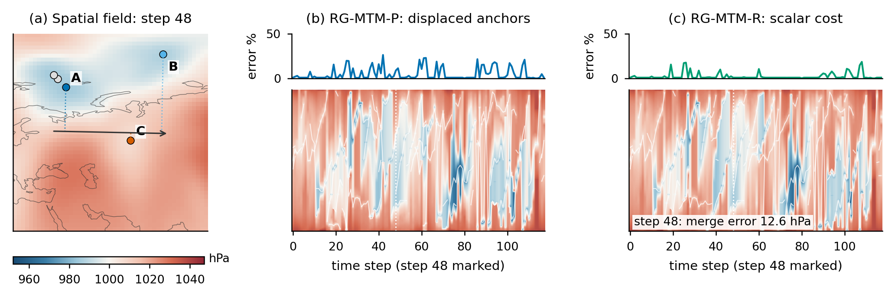

## rgmtm_method_visual

Construction, scalar filling, and disclosed errors.

[SVG](rgmtm_method_visual.svg)

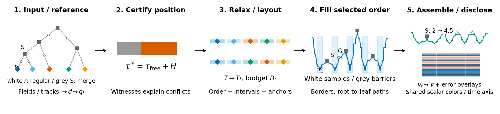

## rgmtm_diagnosis_tradeoff

Packing/hierarchy certificates and exact small-tree frontiers.

[SVG](rgmtm_diagnosis_tradeoff.svg)

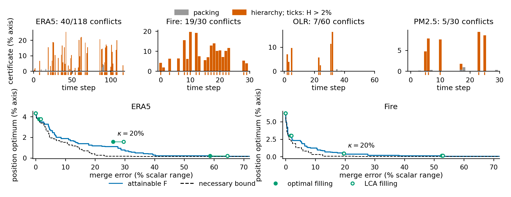

## rgmtm_motion_scalar_cost

Motion errors, paired exploratory intervals, and scalar costs.

[SVG](rgmtm_motion_scalar_cost.svg)

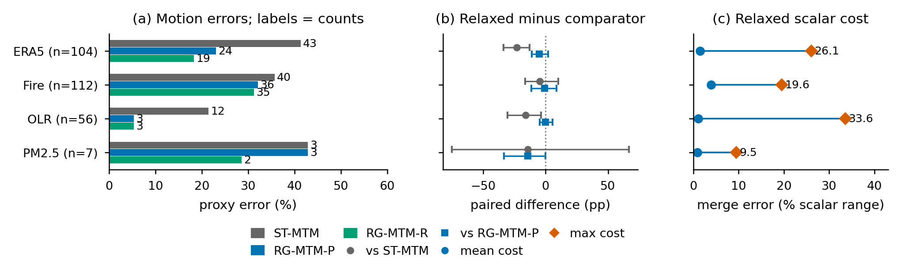

## rgmtm_linked_cases

ERA5 and OLR cases; sequence-level counts and local windows.

[SVG](rgmtm_linked_cases.svg)

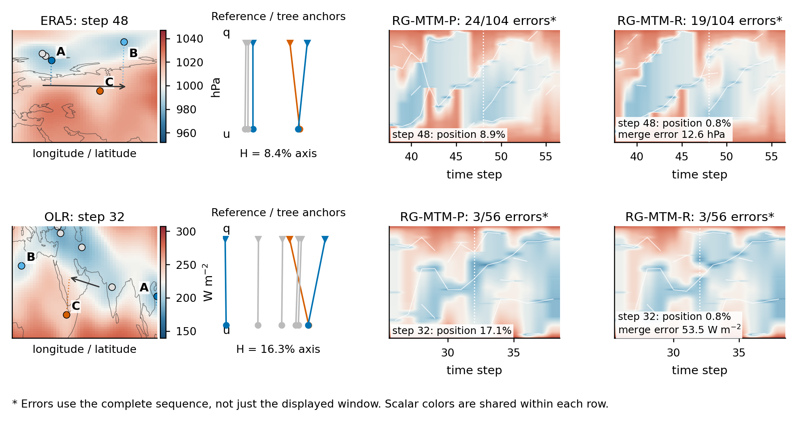

## rgmtm_full_domain_filling

Synthetic augmented-tree samples and scalar correction.

[SVG](rgmtm_full_domain_filling.svg)

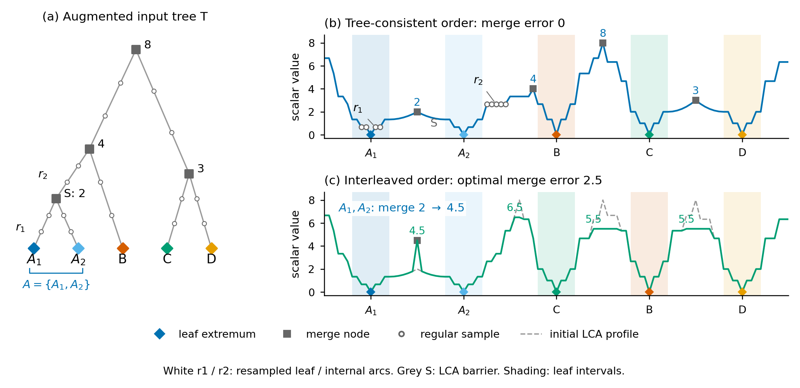

## rgmtm_motion_error_comparison

Total error = reversal + miss, using the declared two-step, 2% setting. Counts are clear 2-D events, not independent samples. No significance claim is encoded by bar height; PM2.5 January was selected after seasonal exploration. Gaussian has no clear events.

[SVG](rgmtm_motion_error_comparison.svg)

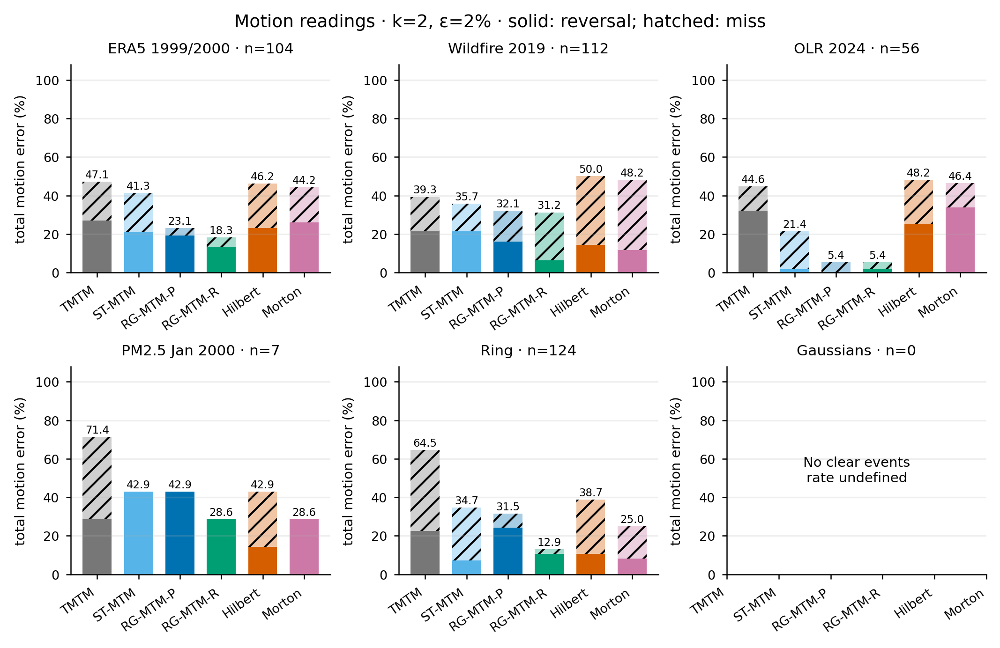

## rgmtm_topology_motion_tradeoff

R uses optimal barrier filling; Hilbert/Morton use their unchanged native scalar sequences. Costs are achieved maxima over frames, not κ bounds. Points show one fixed operating setting, not a Pareto frontier or a statistical superiority claim.

[SVG](rgmtm_topology_motion_tradeoff.svg)

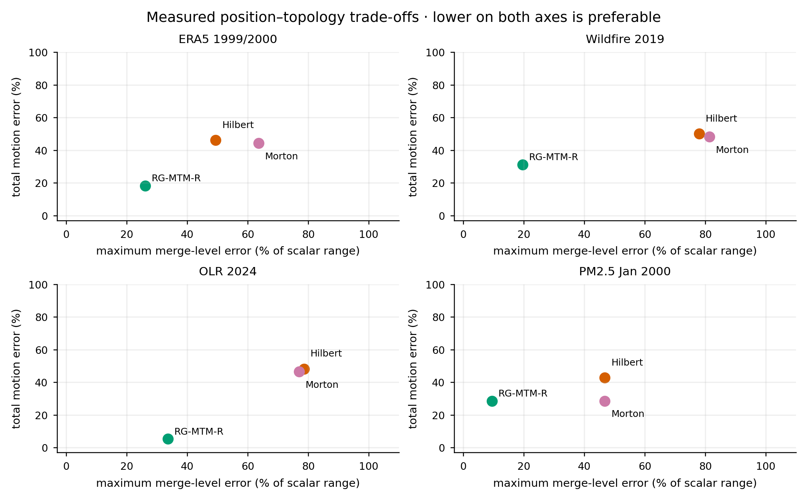

## rgmtm_neighbourhood_preservation

Frame-mean stress and nearest-neighbour preservation from the saved hidden-cost evaluation. These metrics measure spatial relationships, not human performance. Frames with fewer than three extrema are excluded by the shared evaluation protocol.

[SVG](rgmtm_neighbourhood_preservation.svg)

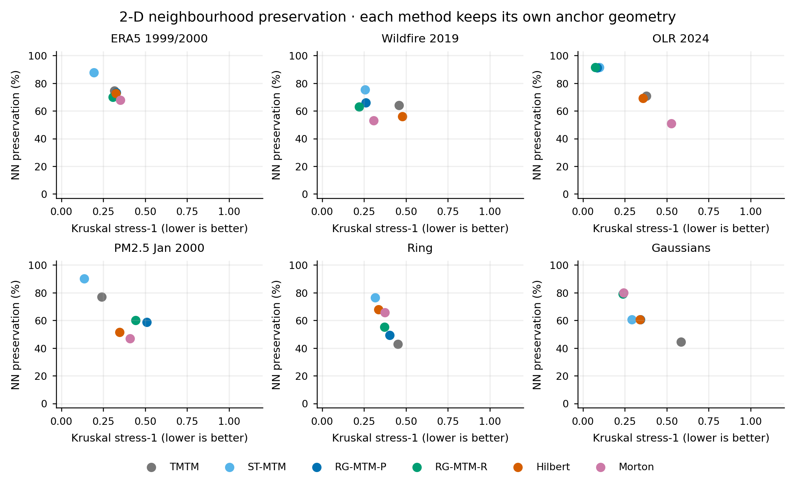

## rgmtm_motion_window_sensitivity

Each k uses its own set of clear events; lines connect operating settings, not physical trajectories. Step duration differs across datasets. Undefined rates are omitted, including Gaussian k=1/2.

[SVG](rgmtm_motion_window_sensitivity.svg)

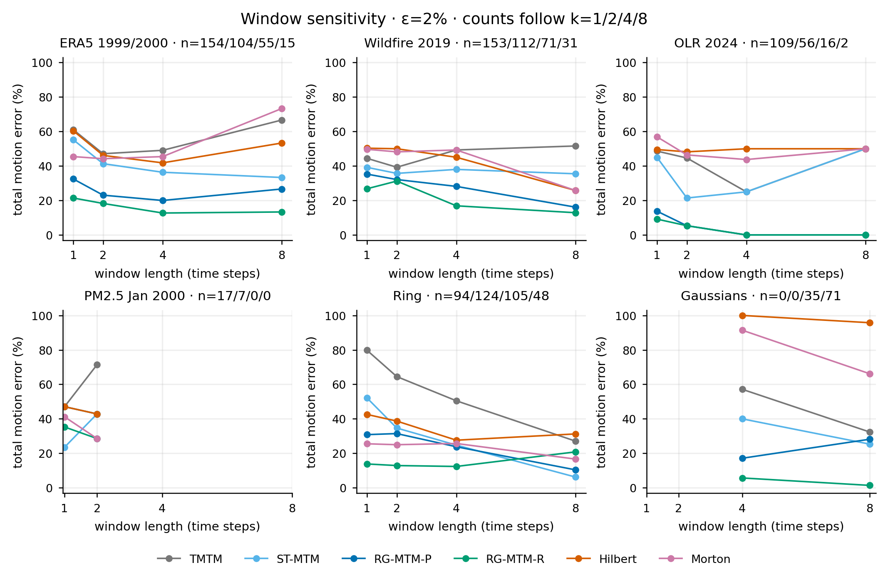

## rgmtm_bisector_absolute_position

Bisector control: TMTM, ST-MTM and RG-MTM-R in side-by-side panels with identical time ranges.

[SVG](rgmtm_bisector_absolute_position.svg)

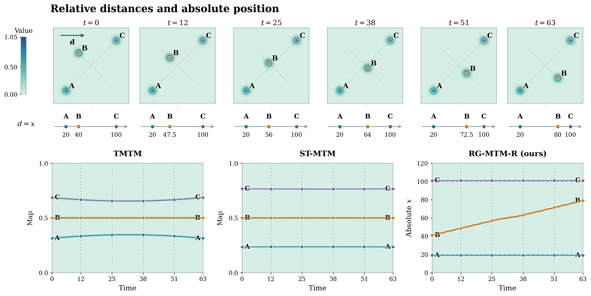
