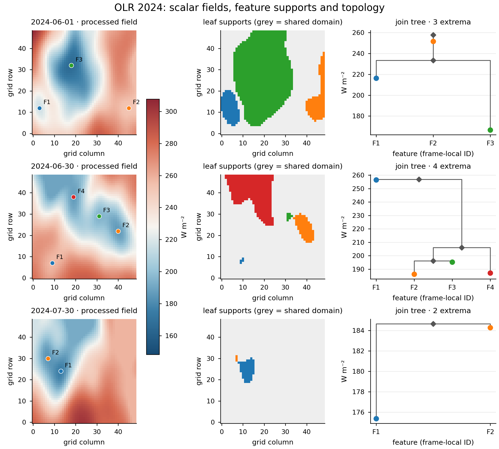
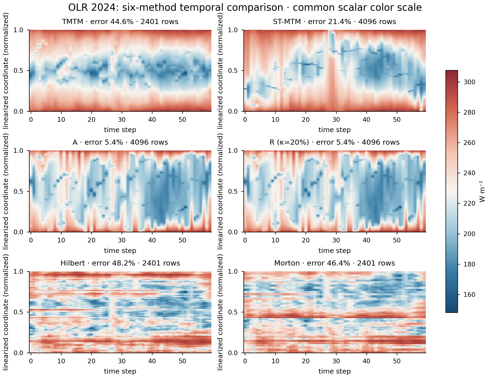
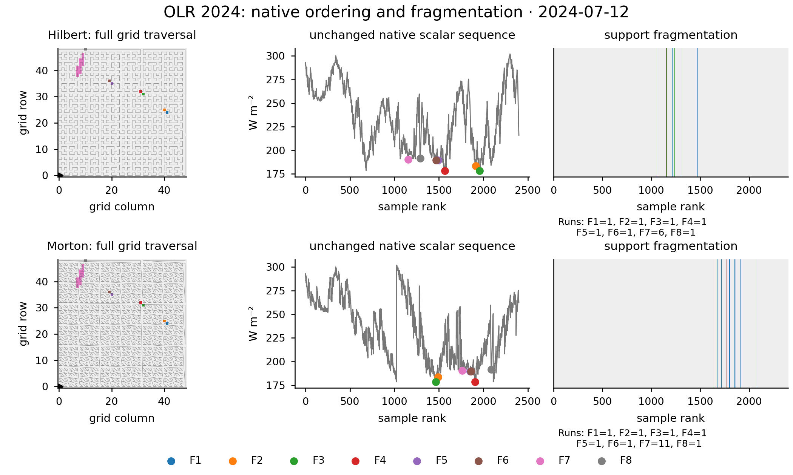
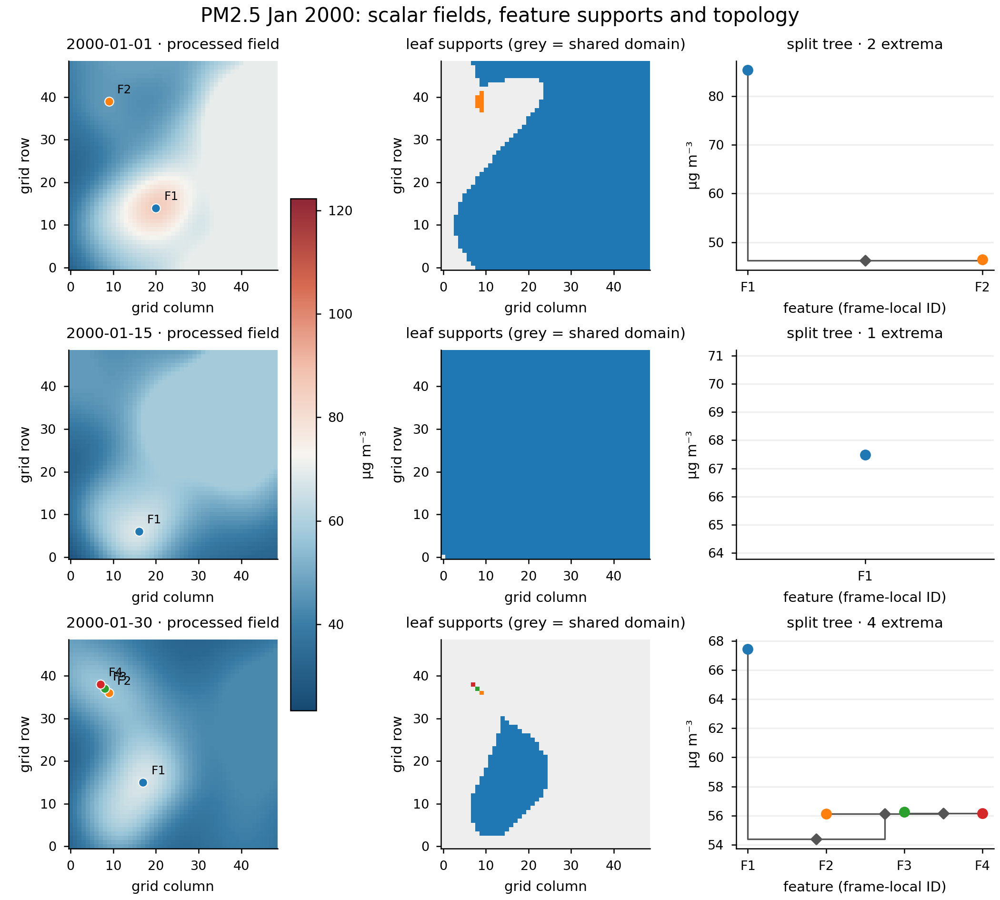
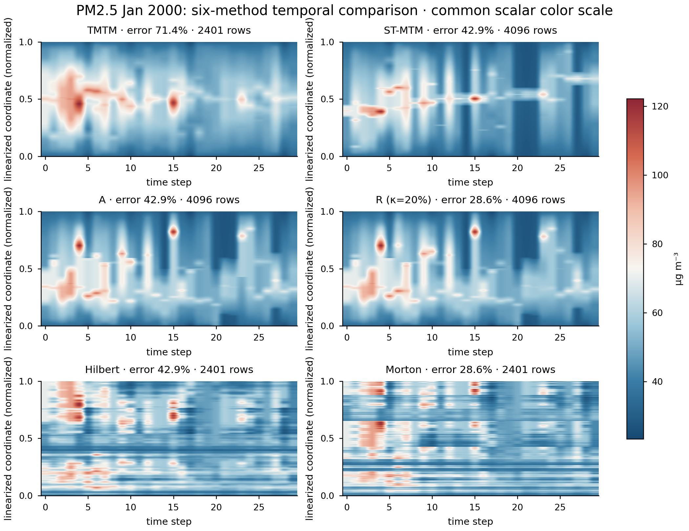
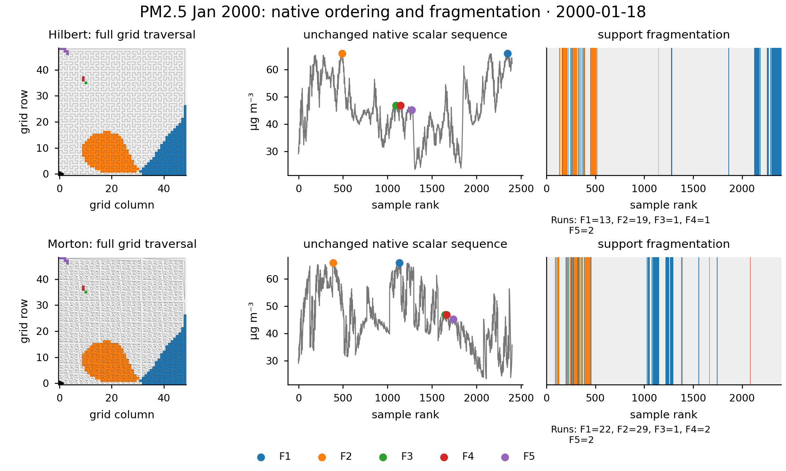
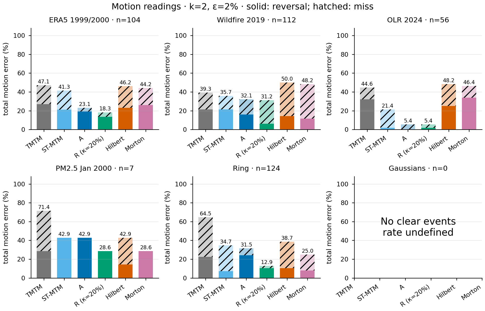
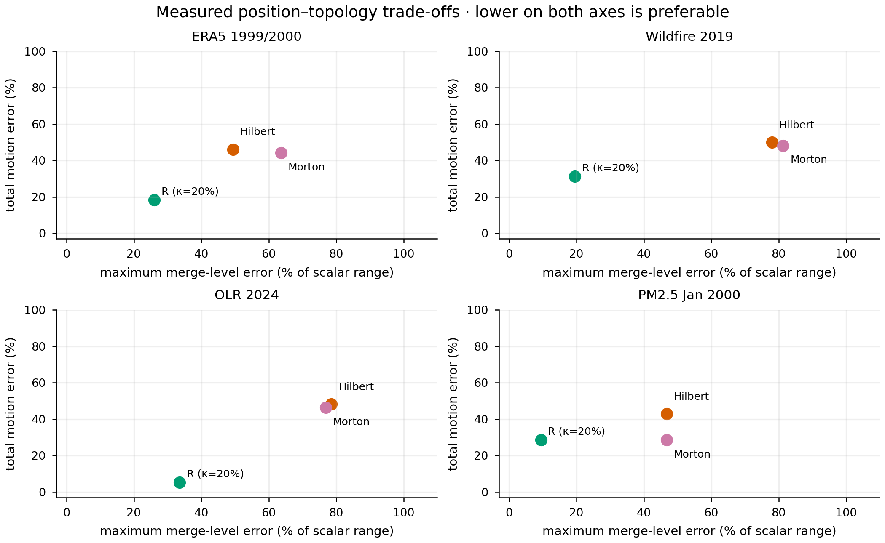
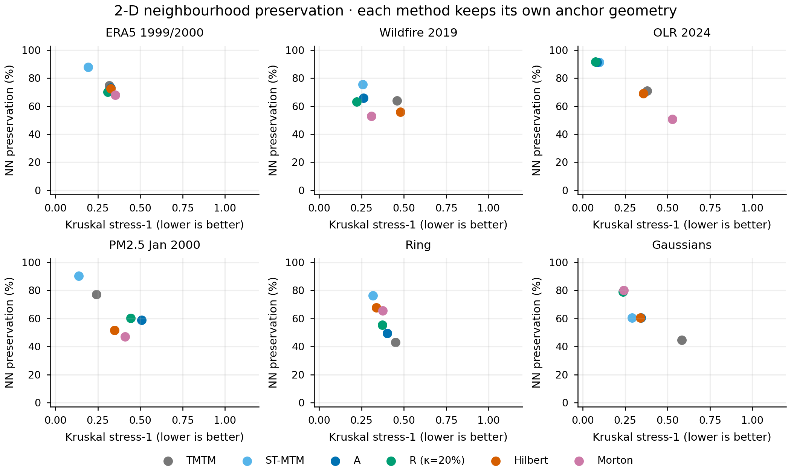
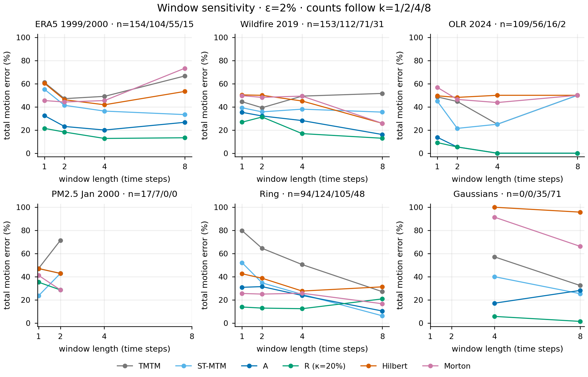

# Dataset and method visualization gallery

Generated from processed scalar arrays and saved experiment JSON, never from existing screenshots.

Six methods: TMTM, ST-MTM, A, R (κ=20%), Hilbert, Morton. Main PM2.5: January 1–30, 2000, selected after seasonal exploration; seven clear events do not establish general superiority.

[Combined figure booklet](visualization-gallery.pdf)

Reproduce: `PYTHONPATH=src:analysis python3 -m visualization.gallery`

Raw-data-free quantitative subset: add `--metrics-only`. PDF and SVG accompany each PNG; SVG keeps editable axes, labels and vector marks. Scalar images remain embedded rasters.

## olr_spatial_topology

Fixed first/middle/last frames. Colors identify frame-local features, not temporal tracks. Trees suppress degree-one nodes and retain scalar heights; grey cells lie outside leaf supports.

[PDF](olr_spatial_topology.pdf) · [SVG](olr_spatial_topology.svg)

## olr_temporal_methods

Common processed fields, scalar range and time axis. Vertical axes are normalized separately; native Hilbert/Morton sample ranks do not represent geographical coordinates. R uses optimal barrier filling. Actual row counts are disclosed; no scalar-value rescaling is used.

[PDF](olr_temporal_methods.pdf) · [SVG](olr_temporal_methods.svg)

## olr_curve_fragmentation

Frame 41: first maximum-extremum-count frame, chosen for structural illustration. Both curves visit every processed grid cell; direction and orientation are fixed. No value interpolation or barrier correction is applied. Fragment counts are for this frame only.

[PDF](olr_curve_fragmentation.pdf) · [SVG](olr_curve_fragmentation.svg)

## pm25_spatial_topology

Fixed first/middle/last frames. Colors identify frame-local features, not temporal tracks. Trees suppress degree-one nodes and retain scalar heights; grey cells lie outside leaf supports.

[PDF](pm25_spatial_topology.pdf) · [SVG](pm25_spatial_topology.svg)

## pm25_temporal_methods

Common processed fields, scalar range and time axis. Vertical axes are normalized separately; native Hilbert/Morton sample ranks do not represent geographical coordinates. R uses optimal barrier filling. Actual row counts are disclosed; no scalar-value rescaling is used.

[PDF](pm25_temporal_methods.pdf) · [SVG](pm25_temporal_methods.svg)

## pm25_curve_fragmentation

Frame 17: first maximum-extremum-count frame, chosen for structural illustration. Both curves visit every processed grid cell; direction and orientation are fixed. No value interpolation or barrier correction is applied. Fragment counts are for this frame only.

[PDF](pm25_curve_fragmentation.pdf) · [SVG](pm25_curve_fragmentation.svg)

## motion_error_comparison

Total error = reversal + miss, using the declared two-step, 2% setting. Counts are clear 2-D events, not independent samples. No significance claim is encoded by bar height; PM2.5 January was selected after seasonal exploration. Gaussian has no clear events.

[PDF](motion_error_comparison.pdf) · [SVG](motion_error_comparison.svg)

## topology_motion_tradeoff

R uses optimal barrier filling; Hilbert/Morton use their unchanged native scalar sequences. Costs are achieved maxima over frames, not κ bounds. Points show one fixed operating setting, not a Pareto frontier or a statistical superiority claim.

[PDF](topology_motion_tradeoff.pdf) · [SVG](topology_motion_tradeoff.svg)

## neighbourhood_preservation

Frame-mean stress and nearest-neighbour preservation from the saved hidden-cost evaluation. These metrics measure spatial relationships, not human performance. Frames with fewer than three extrema are excluded by the shared evaluation protocol.

[PDF](neighbourhood_preservation.pdf) · [SVG](neighbourhood_preservation.svg)

## motion_window_sensitivity

Each k uses its own set of clear events; lines connect operating settings, not physical trajectories. Step duration differs across datasets. Undefined rates are omitted, including Gaussian k=1/2.

[PDF](motion_window_sensitivity.pdf) · [SVG](motion_window_sensitivity.svg)

